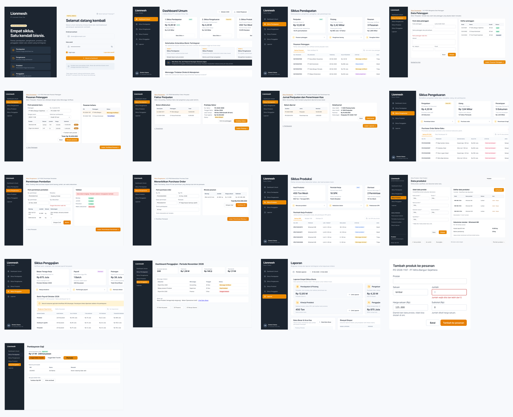

# Figma Screenshots

Status: **Reference only** · exported 2026-11-17
Source: Figma **“DESAIN UI SIA (Copy)”** — file key `Np8oosi3jZuSuoaQGbf5sb`
Scale: 1× PNG, current plugin state

These are raw exports from the Figma file. They are here so the team can see the
visual style while slicing. They are **not** the layout contract: use
`../LAYOUTS.md` for composition, `../DESIGN_TOKENS.md` for values, and
`../COMPONENTS.md` for anatomy.



---

## 1. What to use

| File | Figma node | Page | Size | Pattern | State |
|---|---|---|---|---|---|
| `01-login.png` | `86:1894` | keseluruhan | 1280×760 | Auth | **Raw / clipped** |
| `02-dashboard-umum.png` | `86:1974` | keseluruhan | 1280×760 | Dashboard | **Raw / clipped** |
| `03-hub-pendapatan.png` | `86:1550` | keseluruhan | 1280×760 | Hub | **Raw / clipped** |
| `04-data-pelanggan.png` | `2:7` | pendapatan | 1280×760 | Master data 6/6 | Clean |
| `05-pesanan-pelanggan.png` | `287:211` | pendapatan | 1280×760 | Transaction 7/5 | Clean |
| `06-faktur-penjualan.png` | `2:32` | pendapatan | 1280×760 | Document 6/6 | Clean |
| `07-jurnal-penjualan-kas.png` | `2:47` | pendapatan | 1280×760 | Ledger 6/6 | Clean |
| `08-hub-pengeluaran.png` | `86:1020` | keseluruhan | 1280×760 | Hub | **Raw / clipped** |
| `09-permintaan-pembelian-pg02.png` | `147:3983` | pengeluaran & produksi | 1280×760 | Transaction 6/6 | Clean |
| `10-purchase-order-pg06.png` | `147:4420` | pengeluaran & produksi | 1280×760 | Transaction 6/6 | Clean |
| `11-hub-produksi.png` | `86:753` | keseluruhan | 1280×760 | Hub | **Raw / clipped** |
| `12-data-produksi.png` | `206:635` | pengeluaran & produksi | 1280×760 | Master data 5/7 | Clean |
| `13-hub-penggajian.png` | `86:509` | keseluruhan | 1280×760 | Hub | **Raw / clipped** |
| `14-dashboard-penggajian.png` | `86:3843` | keseluruhan | 1280×720 | Payroll prototype | Prototype |
| `15-laporan.png` | `86:291` | keseluruhan | 1280×760 | Report | **Raw / clipped** |
| `16-dialog-tambah-produk.png` | `50:81` | pendapatan | 520×454 | Dialog | Clean |
| `17-pembayaran-gaji.png` | `86:4174` | keseluruhan | 1280×720 | Payroll prototype | Prototype |

“Clean” means the screen uses the 200px module shell and the 1016px content
width. “Raw / clipped” means the screen still uses the old 288px hub shell with
1568px content; the right side is cut off. “Prototype” means it was captured
from a 1280×720 payroll iframe, not a 760px app page.

## 2. Best references per pattern

| Pattern | Use |
|---|---|
| App shell + 6/6 master data | `04-data-pelanggan.png` |
| 7/5 transaction with line items | `05-pesanan-pelanggan.png` |
| 6/6 document preview | `06-faktur-penjualan.png` |
| 6/6 ledger entry | `07-jurnal-penjualan-kas.png` |
| 6/6 form + validation | `09-permintaan-pembelian-pg02.png` |
| 6/6 form + summary | `10-purchase-order-pg06.png` |
| 5/7 master data + BOM | `12-data-produksi.png` |
| Dialog 520 | `16-dialog-tambah-produk.png` |
| Payroll dashboard / payment | `14-dashboard-penggajian.png`, `17-pembayaran-gaji.png` |

Start with `04`, then `05`. Together they cover the shell, page header, two-column
form, line-item table, totals, list panel, action bar, badges, and table rows.

## 3. Known defects in the raw screenshots

These are visible in the images. Do not reproduce them.

| Where | What is wrong | Target |
|---|---|---|
| `02`, `03`, `08`, `11`, `13`, `15` | 288px hub sidebar; 1568px content inside 992px; third/fourth cards and table columns are clipped | 200px shell; 12-column grid; content 1016 at 1280 |
| `01-login.png` | Left panel is 560×1080 inside a 760px page; the fourth cycle card and footer are cut | 43.75% brand panel, 100vh, 3 cycle cards |
| `14`, `17` | 1280×720 iframe prototype; no 760px page height | Same shell; 760px page height in the app |
| Buttons | Some primary buttons use white text on orange (2.53:1) | `ink-900` `#1C2530` on `brand-500` `#ED8B00` (6.11:1) |
| Page titles | 24–28px in several screens | `text-title` 20/28/700 |
| Bottom action bar | 38–48px in prototypes | 64px sticky `ActionBar` |
| Tables | Some numbers are left aligned | Right aligned, tabular |
| Status | Some badges rely on color more than text | Text + badge |
| Cards | Nested cards and multiple radii | One surface + dividers; 12/8/4 radius |
| `86:3840` payroll Data Karyawan | Sidebar at x=10, content 1119px, 49px overflow; title sits under the sidebar | Not included; use `14`/`17` and the 200px shell |

The Figma file currently has **0 variables and 0 text styles**. The token and
component documents in `../` are the source of truth, not the raw layer values.

## 4. Re-exporting

The exports were made with the Figma Desktop Bridge plugin at scale 1. A hidden
Figma window can suspend `exportAsync` and make the plugin time out; bring the
Figma window to the active workspace first, then export the node.

Node IDs are stable for this file. Export as PNG at 1×; do not resize the frame.
If a new screen is added, name it `18-<screen>.png`, add it to the table, and
regenerate the contact sheet:

```bash
magick montage [0-9][0-9]-*.png -label '%f' -thumbnail 320x190 -tile 4x \
  -geometry +12+18 -background '#F7F9FC' -fill '#1C2530' \
  -pointsize 11 contact-sheet.png
```

Do not modify the Figma file to make a screenshot look better. Fix the layout in
code against `../LAYOUTS.md`.
